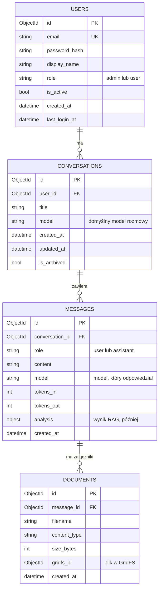

# Plan implementacji backendu MitreAI

Status: zaakceptowany, w realizacji. Postęp i opis działania: [STAN_PROJEKTU.md](STAN_PROJEKTU.md).

## 1. Cel etapu

Działający backend aplikacji czatu w stylu ChatGPT, gotowy pod późniejsze podpięcie modeli (LLM + RAG nad MITRE ATT&CK):

- logowanie e-mailem i hasłem, konta zakłada administrator,
- każdy użytkownik ma własne rozmowy z pełną historią wiadomości,
- do wiadomości można dołączać dokumenty (pliki),
- użytkownik wybiera model; na razie zamiast modelu działa atrapa (mock), która zwraca stały tekst z nazwą wybranego modelu,
- dokumentacja API w Swaggerze,
- backend i baza w osobnych kontenerach; frontend (React) dojdzie w kolejnym etapie jako osobny kontener.

## 2. Ustalenia

| Temat | Decyzja |
|---|---|
| Baza danych | MongoDB |
| Logowanie | Dowolny e-mail i hasło, hasło hashowane (argon2) |
| Zakładanie kont | Tylko administrator, brak samodzielnej rejestracji |
| „Sesja” | Jedna rozmowa (czat); osobnej tabeli sesji logowania nie ma |
| „Opcje gadania” | Wybór modelu |
| Dokumenty | Osobna kolekcja `documents` powiązana z wiadomością (`message_id`), pliki w GridFS |
| Odpowiedź modelu | Na razie stały tekst z nazwą wybranego modelu |

Mongo przechowuje dane natywnie jako dokumenty JSON (BSON), więc rekordy użytkowników, rozmów i wiadomości to po prostu dokumenty w kolekcjach. Pliki (PDF, DOCX itp.) zapisujemy przez GridFS: mechanizm Mongo, który dzieli plik na kawałki i omija limit 16 MB na pojedynczy dokument. W kolekcji `documents` trzymamy metadane pliku i identyfikator pliku w GridFS.

## 3. Stos technologiczny

| Warstwa | Wybór |
|---|---|
| Język i pakiety | Python 3.13, uv (`pyproject.toml` + `uv.lock`) |
| Framework API | FastAPI (Swagger pod `/docs`, ReDoc pod `/redoc`) |
| Serwer | uvicorn |
| Baza | MongoDB 8.0, ODM Beanie 2 (modele na Pydantic) na asynchronicznym PyMongo (`AsyncMongoClient`) |
| Pliki | GridFS (`gridfs.AsyncGridFSBucket` z PyMongo) |
| Hasła | `pwdlib[argon2]` |
| Tokeny | PyJWT (JWT, HS256) |
| Konfiguracja | `pydantic-settings` (zmienne środowiskowe, plik `.env`) |
| Formularze i upload | `python-multipart` |
| Walidacja e-maila | `email-validator` |
| Testy | pytest, pytest-asyncio, httpx |

Wersje są przypięte w `backend/uv.lock`. Beanie 2.x nie używa już Motora, tylko asynchronicznego API PyMongo; z PyMongo bierzemy też asynchroniczny GridFS.

## 4. Struktura repozytorium

Backend jest podzielony na warstwy: kontroler (endpointy) → serwis (logika) → repozytorium (baza) → model. Szkielet z tym podziałem już istnieje; poniżej stan docelowy po wszystkich krokach z sekcji 12.

```
backend/app/
├── main.py                    # aplikacja FastAPI, lifespan (połączenie z bazą, konto admina)
├── dependencies.py            # łączenie warstw przez Depends, bieżący użytkownik, wymóg admina
├── core/
│   ├── config.py              # Settings z pydantic-settings
│   ├── database.py            # klient Mongo, inicjalizacja Beanie
│   └── security.py            # hashowanie haseł, JWT
├── controllers/               # endpointy, bez logiki i bez dostępu do bazy
│   ├── health_controller.py
│   ├── auth_controller.py
│   ├── user_controller.py
│   ├── llm_model_controller.py
│   ├── conversation_controller.py
│   ├── message_controller.py
│   └── document_controller.py
├── services/                  # logika biznesowa, bez wiedzy o HTTP
│   ├── health_service.py
│   ├── auth_service.py
│   ├── user_service.py
│   ├── conversation_service.py
│   ├── message_service.py
│   ├── document_service.py
│   └── llm/                   # interfejs dostawcy modelu + MockProvider
├── repositories/              # jedyne miejsce z zapytaniami do bazy
│   ├── health_repository.py
│   ├── user_repository.py
│   ├── conversation_repository.py
│   ├── message_repository.py
│   └── document_repository.py # metadane + pliki w GridFS
├── models/                    # kolekcje: User, Conversation, Message, DocumentFile
└── schemas/                   # modele żądań i odpowiedzi API
```

Frontend (React + Vite) jest w `frontend/`: `pages/` na widoki pod adresami, `components/` na komponenty wielokrotnego użytku (`ui/`, `layout/` i katalogi funkcji, np. `chat/`), a `api/`, `hooks/` i `types/` na komunikację z backendem.

## 5. Model danych



### Relacje

- Użytkownik 1 : N rozmów. Każda rozmowa należy do dokładnie jednego użytkownika (`user_id`).
- Rozmowa 1 : N wiadomości (`conversation_id`).
- Wiadomość 1 : N dokumentów (`message_id`). Dokumenty dołącza tylko użytkownik, do własnych wiadomości.
- Wiadomości i dokumenty nie mają własnego `user_id`. Właściciela ustalamy przez rozmowę.

### Uwagi do pól

- `role` w wiadomości przyjmuje wartości `user` i `assistant`. To konwencja API modeli, więc historię przekażemy do modelu bez tłumaczenia pól.
- Liczby znaków nie zapisujemy, bo wynika z `content`. Zapisujemy tokeny (`tokens_in`, `tokens_out`), które decydują o koszcie i o tym, ile historii zmieści się w kontekście modelu. Atrapa modelu zostawia je puste.
- `model` jest w dwóch miejscach. W rozmowie to model domyślny, w wiadomości to model, który faktycznie odpowiedział. Użytkownik może zmienić model w trakcie rozmowy.
- `analysis` zostaje puste do czasu podpięcia RAG. Potem trafi tam lista technik ATT&CK ze źródłami.
- `title` ustawiamy automatycznie z początku pierwszej wiadomości, jeśli użytkownik nie poda własnego.
- `updated_at` w rozmowie odświeżamy przy każdej nowej wiadomości. Po nim sortujemy historię w panelu bocznym.

### Indeksy

| Kolekcja | Indeks |
|---|---|
| `users` | `email` (unikalny) |
| `conversations` | `(user_id, updated_at malejąco)` |
| `messages` | `(conversation_id, created_at)` |
| `documents` | `message_id` |

### Usuwanie

- Archiwizacja (`is_archived = true`) chowa rozmowę z listy, ale niczego nie kasuje.
- Twarde usunięcie rozmowy kasuje kaskadowo jej wiadomości, metadane dokumentów i pliki w GridFS.

## 6. Logowanie i uprawnienia

- `POST /auth/login` przyjmuje formularz OAuth2 (`username` = e-mail, `password`) i zwraca token JWT. Dzięki temu w Swaggerze działa przycisk „Authorize”.
- Token zawiera `sub` (id użytkownika) i `exp` (domyślnie 60 minut). Przy każdym żądaniu sprawdzamy, czy konto istnieje i jest aktywne.
- Hasła hashujemy argon2 przez `pwdlib`. Hasło w postaci jawnej nigdzie nie jest zapisywane ani logowane.
- Nie ma samodzielnej rejestracji. Konta tworzy administrator przez `POST /users`.
- Pierwsze konto administratora powstaje przy starcie aplikacji ze zmiennych `ADMIN_EMAIL` i `ADMIN_PASSWORD`, ale tylko jeśli w bazie nie ma jeszcze żadnego admina.
- Konta nieaktywnego (`is_active = false`) nie da się użyć do logowania ani z wcześniej wydanym tokenem.
- Dostęp do cudzej rozmowy, wiadomości albo dokumentu zwraca 404, a nie 403. Nie zdradzamy w ten sposób, że zasób istnieje.
- W tym etapie nie ma refresh tokenów ani wylogowania po stronie serwera. Wylogowanie po stronie frontendu polega na usunięciu tokenu.

## 7. Endpointy API

| Metoda | Ścieżka | Kto | Opis |
|---|---|---|---|
| GET | `/health` | publiczny | Stan aplikacji i połączenia z bazą |
| POST | `/auth/login` | publiczny | Logowanie, zwraca token JWT |
| GET | `/auth/me` | zalogowany | Dane bieżącego użytkownika |
| POST | `/users` | admin | Utworzenie konta |
| GET | `/users` | admin | Lista kont |
| PATCH | `/users/{id}` | admin | Zmiana roli, aktywności, reset hasła |
| GET | `/models` | zalogowany | Lista dostępnych modeli |
| GET | `/conversations` | zalogowany | Moje rozmowy, od najnowszej; `?archived=true` pokazuje archiwum |
| POST | `/conversations` | zalogowany | Nowa rozmowa (`model`, opcjonalnie `title`) |
| GET | `/conversations/{id}` | właściciel | Szczegóły rozmowy |
| PATCH | `/conversations/{id}` | właściciel | Zmiana tytułu, modelu, archiwizacja |
| DELETE | `/conversations/{id}` | właściciel | Twarde usunięcie z wiadomościami i dokumentami |
| GET | `/conversations/{id}/messages` | właściciel | Wiadomości chronologicznie, z metadanymi dokumentów |
| POST | `/conversations/{id}/messages` | właściciel | Wysłanie promptu (opis niżej) |
| GET | `/documents/{id}` | właściciel | Pobranie pliku |

### Wysłanie promptu: `POST /conversations/{id}/messages`

Żądanie jest typu `multipart/form-data`:

- `content` (tekst promptu, wymagany),
- `model` (opcjonalny; domyślnie model rozmowy),
- `files` (opcjonalne pliki, może być kilka).

Pliki idą razem z promptem, a nie osobnym żądaniem po fakcie. Model musi mieć dostęp do załączników w chwili, gdy generuje odpowiedź.

Przebieg:

1. Sprawdzenie, czy rozmowa należy do użytkownika i czy wybrany model jest na liście dostępnych (w przeciwnym razie 422).
2. Sprawdzenie plików: limit rozmiaru i dozwolone typy.
3. Zapis wiadomości użytkownika (`role = user`).
4. Zapis plików w GridFS i ich metadanych w `documents` z `message_id` tej wiadomości.
5. Wywołanie dostawcy modelu z historią rozmowy i dokumentami. Na razie odpowiada atrapa.
6. Zapis odpowiedzi (`role = assistant`, `model`, tokeny, `analysis`).
7. Aktualizacja rozmowy: `updated_at`, ewentualnie `title` przy pierwszej wiadomości.
8. Odpowiedź: obie wiadomości (użytkownika z dokumentami i asystenta).

Przykładowa odpowiedź atrapy: `"Odpowiedź z modelu mock-small"`.

## 8. Warstwa modeli

- Interfejs dostawcy: `generate(model, history, documents) -> ModelReply` z polami `content`, `tokens_in`, `tokens_out`, `analysis`.
- `MockProvider` zwraca stały tekst z nazwą modelu, a tokeny i `analysis` zostawia puste.
- Lista dostępnych modeli pochodzi z konfiguracji (`AVAILABLE_MODELS`). Na start są dwie nazwy testowe, np. `mock-small` i `mock-large`.
- Prawdziwe modele (lokalne albo przez API) i pipeline RAG podepniemy później w tym samym miejscu, bez zmian w endpointach.

## 9. Konfiguracja

Plik `.env` (poza repozytorium) według wzoru `.env.example`:

| Zmienna | Znaczenie | Przykład |
|---|---|---|
| `MONGO_URL` | Adres bazy | `mongodb://mongo:27017` |
| `MONGO_DB` | Nazwa bazy | `mitreai` |
| `JWT_SECRET` | Klucz do podpisu tokenów, wymagany, bez wartości domyślnej | losowy ciąg |
| `JWT_EXPIRE_MINUTES` | Ważność tokenu | `60` |
| `ADMIN_EMAIL` | E-mail pierwszego admina | |
| `ADMIN_PASSWORD` | Hasło pierwszego admina | |
| `AVAILABLE_MODELS` | Lista modeli (JSON) | `["mock-small","mock-large"]` |
| `MAX_UPLOAD_MB` | Limit rozmiaru pliku | `10` |
| `CORS_ORIGINS` | Adresy frontendu | `["http://localhost:5173"]` |

## 10. Docker

- `backend/Dockerfile`: obraz `python:3.13-slim`, binarka uv z oficjalnego obrazu `ghcr.io/astral-sh/uv` (wersja przypięta), `uv sync --frozen --no-dev`, uruchomienie jako użytkownik bez uprawnień roota, start przez uvicorn na porcie 8000.
- `frontend/Dockerfile`: budowanie w `node:24-alpine`, serwowanie przez `nginx:1.28-alpine`; nginx przekazuje `/api/` do backendu.
- `docker-compose.yml`:
  - `mongo`: obraz `mongo:8.0`, wolumen na dane, healthcheck przez `mongosh`, port wystawiony tylko na `127.0.0.1`,
  - `backend`: build z `./backend`, zmienne z `.env`, start dopiero po zdrowym `mongo`, healthcheck na `/api/health`, port 8000,
  - `frontend`: build z `./frontend`, start dopiero po zdrowym backendzie, port 8080.
- Wszystkie endpointy mają prefiks `/api`, Swagger jest pod `/api/docs`.
- Uwaga: MongoDB od wersji 5 wymaga procesora z AVX. W BBQShop był z tym problem w CI, więc tam obraz dobieramy do runnera.

## 11. Testy

Testy działają na prawdziwym Mongo w kontenerze, na osobnej bazie testowej czyszczonej po każdym teście. Klient to `httpx.AsyncClient` podpięty bezpośrednio pod aplikację.

Scenariusze:

- logowanie: poprawne dane, złe hasło, konto nieaktywne,
- zwykły użytkownik nie może tworzyć kont, admin może,
- konto admina tworzy się przy starcie tylko wtedy, gdy żadnego nie ma,
- tworzenie, lista, zmiana i archiwizacja rozmów,
- użytkownik A nie widzi rozmów, wiadomości ani dokumentów użytkownika B (404),
- wysłanie promptu zapisuje obie wiadomości, a odpowiedź zawiera nazwę wybranego modelu,
- model spoza listy daje 422,
- upload i pobranie dokumentu, przekroczony limit rozmiaru,
- usunięcie rozmowy kasuje wiadomości, dokumenty i pliki w GridFS.

## 12. Kolejność prac

Gałęzie: `feature/...` → `develop` → `main`. Każdy krok to osobny commit. Push i PR dopiero po akceptacji.

1. **Szkielet (zrobione, gałąź `feature/backend`):** backend w warstwach z `/api/health`, frontend z `pages/` i `components/`, trzy kontenery w `docker-compose.yml`. Swagger pod `http://localhost:8000/api/docs`.
2. **Baza (modele zrobione w szkielecie):** konfiguracja, połączenie z Mongo, modele Beanie z indeksami.
3. **Logowanie (zrobione):** hashowanie argon2, JWT, `/api/auth/login`, `/api/auth/me`, konto admina przy starcie. Frontend: formularz logowania, ochrona tras, wylogowanie.
4. **Użytkownicy (zrobione):** endpointy admina.
5. **Rozmowy (zrobione):** CRUD i sprawdzanie właściciela.
6. **Wiadomości (zrobione):** wysyłanie promptu, atrapa modelu, `/models`. Prompt jest formularzem bez plików; pliki dojdą w kroku 7.
7. **Dokumenty:** upload w wysyłce promptu, pobieranie, kaskadowe usuwanie.
8. **Testy i README:** scenariusze z sekcji 11, instrukcja uruchomienia.

## 13. Otwarte kwestie

- Jakie typy plików dopuszczamy (PDF, TXT, DOCX?) i jaki limit rozmiaru? Propozycja: PDF, TXT, MD, DOCX, do 10 MB na plik.
- Czy model ma czytać treść dokumentów? Wymaga to wyciągania tekstu z plików. Proponuję odłożyć to do etapu podpinania modeli.
- Strumieniowanie odpowiedzi (efekt pisania jak w ChatGPT) przez SSE. Ma sens dopiero przy prawdziwym modelu.
- Lista prawdziwych modeli. Do ustalenia, na razie nazwy testowe.
- Refresh tokeny i wylogowanie po stronie serwera. Na razie bez.
